# Binance Studio

**English** | [简体中文](README.zh-CN.md)

A local-first Chrome / Edge extension for customizing the appearance and trading layout of **Binance Global at `https://www.binance.com`**. Choose a theme, arrange panels, and build a personal trading workspace without an API key.

The extension has no third-party runtime dependencies. The extension interface and project documentation are available in English and Mandarin (Simplified Chinese).

- **Make the toolbar yours:** drag with the right-hand handle, remember positions, hide at screen edges, and customize tools, order, size and opacity.
- **Arrange your workspace:** a 12-column editor with up to 50 undo/redo steps, edge Dock and saved rooms for each pair.
- **Give quotes a distinct look:** ten digit animations, four lighting effects and three text finishes for the main price and pair name.
- **Keep controls readable:** nine palettes with automatic text contrast correction for supported buttons.

## Preview

Screenshots below use the extension's simulation pages. Prices, depth, trades and room notes are examples; no account is connected. The [Chinese README](README.zh-CN.md) has matching Chinese screenshots.

### Customization console

Adjust themes, colors, typography, and layout with a live preview. All market data in the preview is simulated.

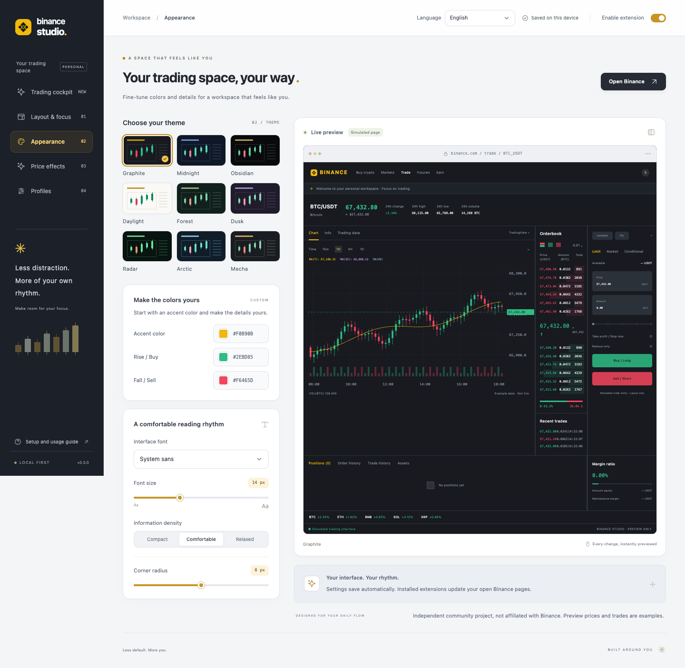

### Toolbar popup

Switch themes, toggle focus mode, or open the full settings console from the browser toolbar.

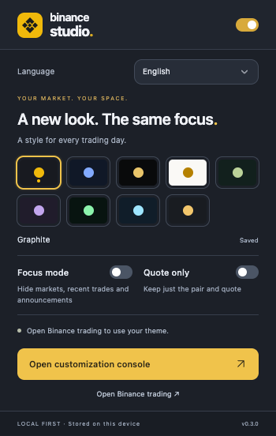

<details>
<summary>Price animations and three text finishes</summary>

**Price effects** combine digit transitions, lighting and text finishes, with a simulated NEARUSDT ticker. Aurora is selected in this example.

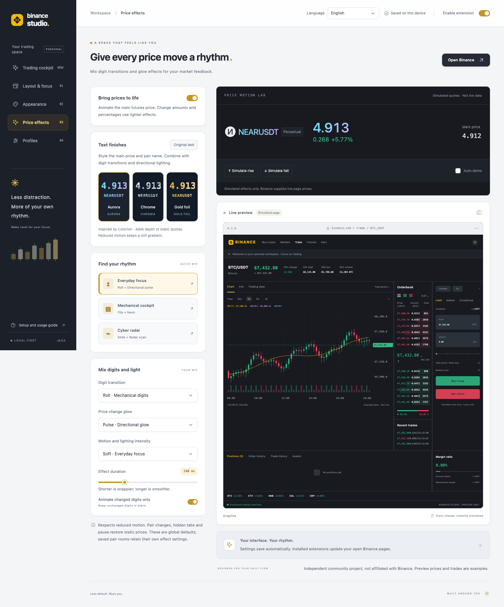

**Aurora, Chrome and Gold foil** can decorate both the main price and the pair name. Each card shows the actual CSS effect; choose **Original text** to reset it.

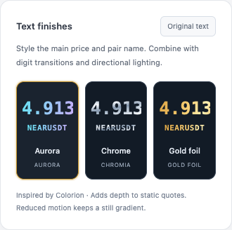

**Digit transitions** include crossfade, horizontal push, blur-to-focus, directional wipe, 3D side rotation and four-piece assembly. This menu is scrolled to the later options; ten animations plus instant updates are available.

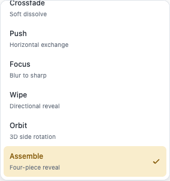

</details>

<details>
<summary>Trading cockpit, toolbar customization, layout history and pair rooms</summary>

**Radar cockpit** includes scenes, an edge Dock and an animated depth display. Prices, depth and trades in this screenshot are examples from the simulation lab.

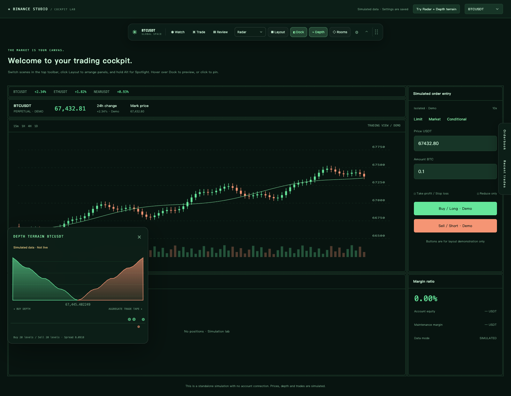

**Toolbar customization** controls tool visibility and order, icons-only mode, size, opacity and edge auto-hide. Toolbar and depth-window positions are remembered locally; hold the toolbar's right-hand six-dot handle to move it.

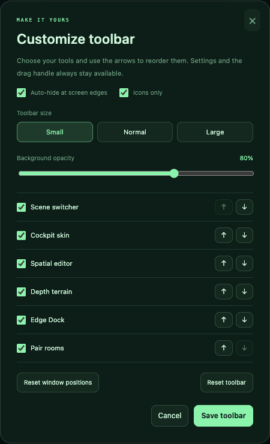

**Spatial editor** supports dragging, resizing, exact coordinates and up to 50 undo/redo steps on a 12-column canvas. Both history controls are available in this draft.

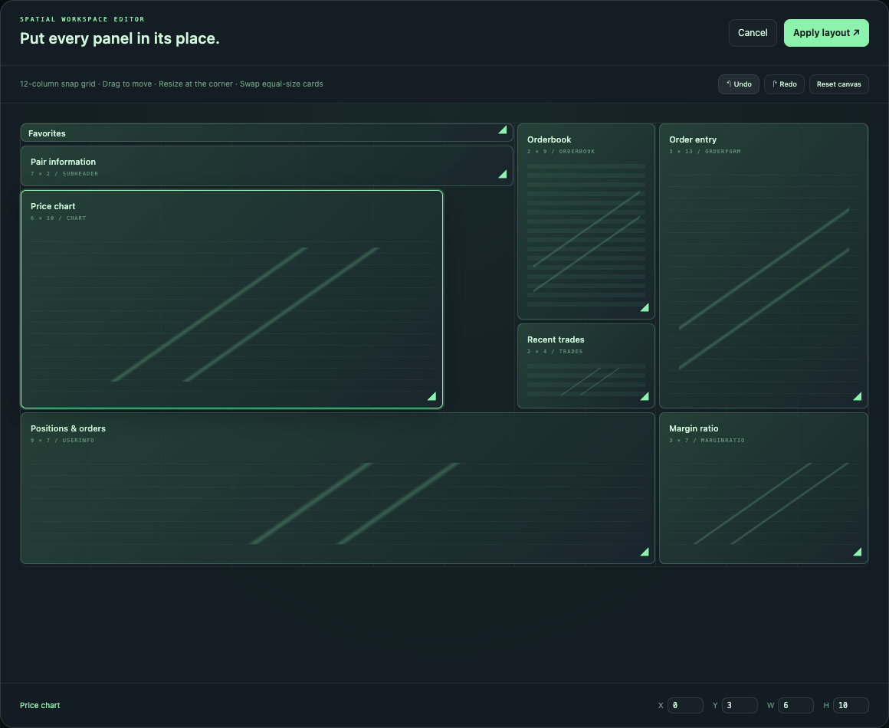

**Pair rooms** save a skin, layout and private note for the selected market. This example contains a saved BTC room and a sample note.

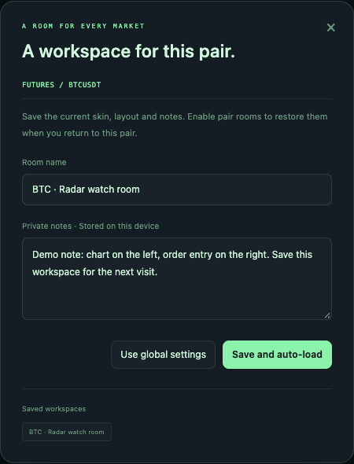

</details>

<details>
<summary>More cockpit skins: Arctic and Mecha</summary>

**Arctic** uses cool blue accents and rounded panels.

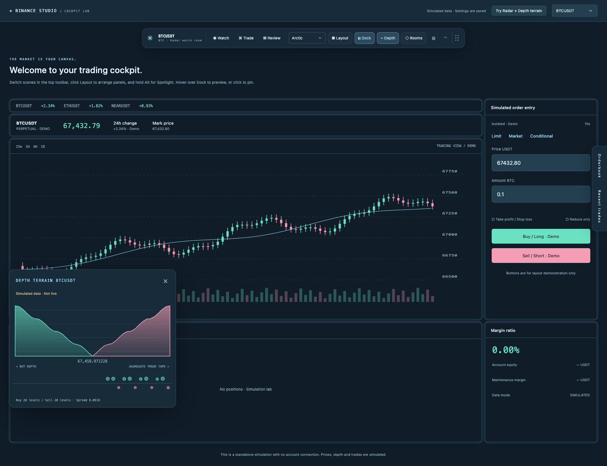

**Mecha** uses amber accents, monospace typography and square panel edges. The same workspace can switch skins from the floating toolbar.

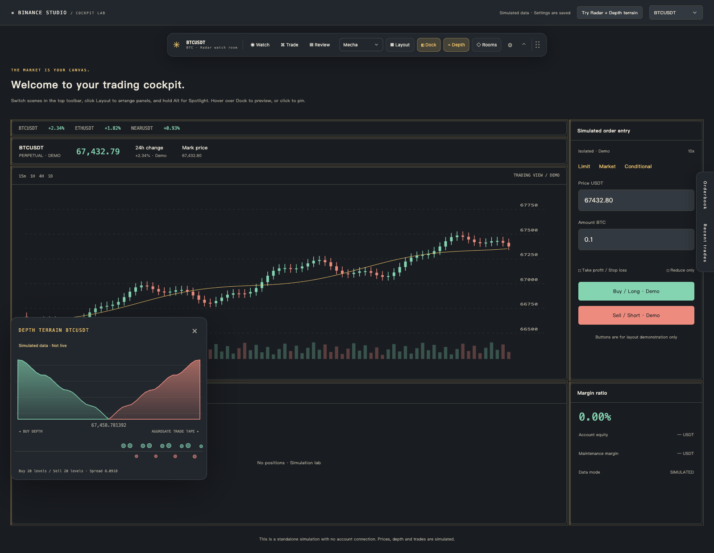

</details>

## Install

1. Download or clone this repository. You can load the source directly, or run `npm run build` and extract `dist/binance-studio-0.3.0.zip`.
2. Open `chrome://extensions` in Chrome or `edge://extensions` in Edge.
3. Enable **Developer mode**, choose **Load unpacked**, and select the folder containing `manifest.json`: either the repository root or `dist/binance-studio`.
4. Open or **refresh** a Binance Global page and pin Binance Studio to the toolbar.
5. Click the extension icon to switch themes, or choose **Open customization console** to open the full customization console.

Settings save automatically and update Binance tabs where the extension is running. Turning off **Enable extension** removes injected styles and panel markers and restores the native presentation.

After updating an existing installation, reload the extension on the extensions page, then refresh your Binance tabs. Chrome 111 or newer is required by the manifest; the extension targets desktop Chromium browsers.

## Interface language

Use the **Language** selector in the toolbar popup or the top bar of the settings console. Choose **English**, **简体中文**, or **Follow browser** (the default). Chinese browser locales use Simplified Chinese; other locales use English.

The choice is saved locally and updates open extension pages and the trading cockpit. It applies to controls, previews, help, validation messages, tooltips and accessibility labels. Language is a global preference, so pair rooms cannot override it. Your Binance page language, room names and private notes stay as entered. The standalone preview saves its own language preference separately.

## UI and controls

The console pairs a graphite sidebar with neutral cards and amber accents. The compact toolbar popup uses the same palette on a dark surface. Dropdowns and color selection use custom panels, including keyboard navigation, typeahead, visible focus states and viewport-aware placement. Color panels offer a preset palette, hue/saturation/lightness controls and validated HEX input. The controls work in both languages and respect reduced motion.

## Features

### Themes and layout

- Nine themes: Graphite, Midnight, Obsidian, Daylight, Forest, Dusk, Radar, Arctic and Mecha.
- Custom accent, buy and sell colors; system or monospace fonts; font size, density and corner radius controls.
- Chart-first and orderbook-preserving focus presets, mirrored layouts, and visibility controls for the orderbook, recent trades, markets and announcements.
- Page width, chart height, orderbook width, order-entry width, positions height and panel spacing controls.
- Automatic space recovery when supported futures panels are hidden; a layout reset that preserves appearance settings.
- A clearly labeled simulated trading preview with a native-style comparison.

### Trading cockpit

Theme colors cover both generations of Binance color tokens. Button labels with insufficient contrast are adjusted to their rendered solid or translucent background, including nested labels and hover/focus changes, without modifying inline styles, values or disabled state. Pausing the extension removes these corrections. Gradient/image backgrounds keep their original treatment.

Use the floating toolbar on a supported trading page, or open **Trading cockpit → Open cockpit lab** in settings. The standalone preview also offers `/lab.html`. The lab uses simulated prices, depth and trades, and its settings changes are saved.

- **Floating toolbar:** hold the six-dot handle on the right to move it. Toolbar position, collapsed state and depth-window position are remembered locally across reloads and pair changes. Drop the toolbar within 24 px of any screen edge to snap it there; after the pointer leaves, it hides behind an edge handle. Hover or focus the handle to reveal it. Settings and open menus keep it visible. Double-click the drag handle to restore the toolbar position, or use **Reset window positions** in its gear menu to reset both windows.
- **Toolbar customization:** the gear opens a live preview for tool visibility/order, icons-only mode, three sizes, background opacity and edge auto-hide. Save commits the changes; Cancel or Esc restores the saved appearance. Settings, collapse and drag controls remain accessible even when all optional tools are hidden. These device-specific preferences are stored separately from rooms and exported profiles.
- **Spatial editor:** drag and resize panel representations on a 12-column grid. Use arrow keys to move, Shift + arrow keys to resize, or enter exact coordinates. Equal-size cards can swap. Undo/redo retains up to 50 edits per editing session; each completed drag is one step. Use the buttons, Ctrl/⌘ Z, Ctrl/⌘ Shift Z or Ctrl/⌘ Y; text and numeric inputs retain their native undo. Resetting the canvas is also undoable. Applying a layout rearranges the original cards through CSS, reveals the included panels and disables Dock. Cancel or Esc discards the draft.
- **Edge Dock:** tuck orderbook, trades, or positions panels against the left or right edge. Hover to preview and click to pin. Original DOM nodes and input values are preserved. Standard layouts reclaim space; custom layouts retain their coordinates.
- **Scenes:** switch between watch, trade and review with optional motion that respects the system reduced-motion preference.
- **Spotlight:** hold Alt to highlight the panel under the pointer. Releasing Alt, pressing Esc, losing focus or changing pages restores normal brightness. Editing fields do not trigger it; cross-origin iframes handle their own keyboard events.
- **Pair rooms:** save a skin, settings, canvas and private note per spot/futures pair. Up to 48 rooms are supported. A background queue serializes room writes from trading tabs. Global pause remains authoritative; settings pages edit global defaults.
- **Four cockpit skins:** Obsidian, Radar, Arctic and Mecha, with further color and font customization.
- **Depth terrain:** cumulative 20-level bid/ask mountains and trade bubbles in a draggable window. This optional feature uses public spot and USDⓈ-M futures streams and follows the current pair. It disconnects when disabled, paused or hidden, and clears stale snapshots on timeouts and reconnects.

### Price effects

Open **Price effects** in settings. The default is a mechanical roll with a directional pulse; quick mixes and individual controls are also available.

- Digit transitions: roll, flip, directional slide, bounce, crossfade, horizontal push, blur-to-focus, directional wipe, 3D side rotation, four-piece assembly, or instant updates. All ten animated transitions work on changed digits and share the duration controls. Focus, 3D rotation and assembly also respond to intensity. New quotes replace in-flight layers immediately; the effects never generate intermediate quote values.
- Lighting: pulse, neon afterglow, radar scan, glitch, or none.
- Soft, medium or strong intensity; 120–600 ms duration; changed-digits-only animation and a separate enable switch.
- Three optional text finishes for the main quote and pair name: **Aurora**, **Chrome** and **Gold foil**, with live sample cards and an **Original text** reset. They also style the cockpit pair label. Reduced motion preserves static gradients; background tabs pause their animation. The original text nodes, font metrics and form fields remain intact. Light themes use darker gradient palettes. The implementations are inspired by Colorion's [Borealis](https://text-effects.colorion.co/effects/aurora-gradient-text-animation/), [Chromia](https://text-effects.colorion.co/effects/chrome-text-effect/) and [Gold-Foil](https://text-effects.colorion.co/effects/gold-text-effect/), with original CSS scoped to the extension's recognized targets and no remote runtime dependencies.
- Manual up/down steps or automatic playback in a simulated NEARUSDT preview, without a live market connection.

Effects target the recognized futures `.ticker-wrap` main price. Change amounts and percentages receive lighter effects. A temporary display layer preserves the site's text nodes, inline styles and trading inputs. Rapid updates replace the current animation; missing quotes clear the layer. Pair changes reset the baseline. Reduced motion, background visibility and pause restore a static display. Room saves and profile exports include these preferences.

### Profiles

Import and export JSON v2 bundles containing global settings, the custom canvas, rooms and notes, up to 1 MB. Legacy v1 settings remain importable. Resetting global defaults preserves saved rooms. Exported bundles include private notes, so review them before sharing.

## Compatibility and limitations

**Compatibility is based on read-only observation of futures page DOM and reconstructed test fixtures. The extension has not completed end-to-end acceptance testing on a live trading page.** Binance can change its markup, and fixture-based tests do not cover every spot/futures page or language. The popup reports whether the futures grid adapter is recognized.

Full layout editing requires a recognized futures grid. The adapter identifies `.react-grid-layout`, `.react-grid-item`, and the `grid-area` values `favorite`, `subheader`, `chart`, `orderbook`, `trades`, `orderform`, `userinfo` and `marginRatio`. With native settings it preserves the site's layout; focus, mirror or sizing adjustments use CSS Grid on the outer cards. Unknown or duplicate regions disable whole-grid rearrangement so new panels are not omitted.

Generic adapters use `PANEL_SELECTORS` in `src/core.js` and may leave empty tracks. Mirroring also supports recognized shared Grid or horizontal Flex containers. Reset the extension's layout before using Binance's native dragging and resizing. Contributions adapting selectors and `GRID_AREAS` are welcome.

Themes use Binance semantic CSS variables and selected control classes. Components with independent styles, Canvas-rendered chart content, and cross-origin iframes may require Binance's own appearance controls. Public depth streams support spot and USDⓈ-M futures, excluding coin-margined futures.

Only `https://www.binance.com/*` and `https://binance.com/*` are supported. Binance.US and other separate regional domains are excluded. Settings pages adapt to small screens; the extension itself targets desktop Chrome / Edge.

## Development

Use **Node.js 20+** and npm. Building a ZIP also requires the system `zip` command. Loading the extension, running the preview, checking source files and running unit tests do not require installing dependencies.

```sh
npm run dev
# Open http://127.0.0.1:4173
# Open http://127.0.0.1:4173/lab.html for the simulated cockpit

npm run check
npm test
npm run build

# Browser tests require the development dependency and Chromium
npm ci
npx playwright install chromium
npm run test:browser
```

| Command | Purpose |
| --- | --- |
| `npm run dev` | Local preview on `127.0.0.1:4173`; override with `PORT` |
| `npm run check` | Check JavaScript syntax, resource references, script order and versions |
| `npm test` | Unit tests for settings, storage, layouts, rooms, prices and market parsing |
| `npm run test:browser` | Run all six browser suites with the actual unpacked extension |
| `npm run test:cockpit` | Cockpit, layout, rooms and market lifecycle tests |
| `npm run test:controls` | Custom dropdowns, color panels, keyboard behavior and popup sizing |
| `npm run test:i18n` | Bilingual UI, language persistence, cross-page sync and input preservation |
| `npm run test:prices` | Price effects and responsive preview tests |
| `npm run build` | Create a clean unpacked extension and versioned ZIP in `dist/` |
| `npm run screenshots` | Refresh all 22 README screenshots in isolated English and Chinese extension profiles |
| `npm run screenshots:en` / `npm run screenshots:zh` | Refresh the 11 screenshots for one language |

The installed extension uses `chrome.storage.local`. The standalone preview uses `localStorage` and has separate settings; use export/import to move them. Multiple pages observe storage changes, and failed writes are reported in the UI.

Browser tests intercept Binance page requests with fixtures from `tests/fixtures/`. Market tests inject fixed-format WebSocket data in the extension's isolated test context. They do not access an account or submit trades. Coverage includes theme persistence, layouts, Dock, Spotlight, rooms, SPA navigation, market reconnects, price transitions, quote replacement, reduced motion, pause and responsive previews. Screenshots and result files go to `output/verification/`.

Set `BROWSER_EXECUTABLE` to use another Chromium executable that supports extension sideloading. Playwright Chromium is the default. CI runs checks, unit tests, builds and browser tests on Node.js 20 and 22.

## Project structure

```text
manifest.json           Extension permissions and entry points
options.html            Full customization console
popup.html              Toolbar popup
lab.html                Simulated trading cockpit
src/storage.js          Shared extension / preview storage boundary
src/i18n.js             Locale selection and scoped UI translation
src/controls.js         Accessible custom dropdowns and menu positioning
src/color-picker.js     Custom color palette, HSL controls and HEX validation
src/locales/en.js       English translations keyed by Mandarin source text
_locales/               Browser-native extension name and description
src/core.js             Settings validation, themes and profile format
src/workspace.js        Canvas, pair rooms, v2 bundles and workspace saves
src/background.js       Initial settings and serialized trading-tab mutations
src/content.js          Style injection, panel recognition and lifecycle
src/cockpit.js          Floating toolbar, editor, Dock and Spotlight
src/market.js           Public market client and depth / trade Canvas
src/price-effects.js    Price transitions and effect lifecycle
src/price-options.js    Price effect controls and simulated ticker
src/experiments.js      Cockpit settings and saved room list
src/options.js          Settings console interactions
src/popup.js            Quick settings and active-page status
src/preview.js          Simulated trading preview
src/lab.js              Simulated trading page
styles/                 Console, popup and preview styles; ui.css contains shell tokens
assets/                 Local icons
scripts/                Preview server, source checks and release packaging
tests/                  Unit tests, browser suites, helpers and fixtures
docs/                   Architecture notes and README screenshots
```

See the [architecture guide](docs/ARCHITECTURE.md) for dependencies and persistence behavior, and the [contribution guide](CONTRIBUTING.md) for development and release conventions. Issues and pull requests in English or Chinese are welcome.

## Permissions and data

The extension requests only `storage` and `activeTab`. Content scripts run automatically only on the two supported Binance Global HTTPS hosts. `activeTab` is used to inspect the active Binance page when you open the popup. No API key, cookie access or analytics collection is used, and the extension does not change order-submission logic.

Depth terrain is off by default. When enabled, it subscribes to public depth and aggregate-trade streams for the current pair. It sends no notes, balances, orders or account information. Futures connections use `wss://fstream.binance.com/public/ws/` and `/market/ws/`; spot uses `wss://stream.binance.com:9443/stream`. Network, regional or site CSP restrictions can prevent a connection; the UI shows its status.

Settings stay on the device and are not synced through a browser account. Uninstalling removes extension storage; export a backup first if needed. Binance Studio is an independent community project and is not affiliated with Binance.

## License

Licensed under the [Apache License 2.0](LICENSE). The package is marked `private: true` to prevent accidental npm publishing; this does not prevent installing or contributing to the extension from source.
