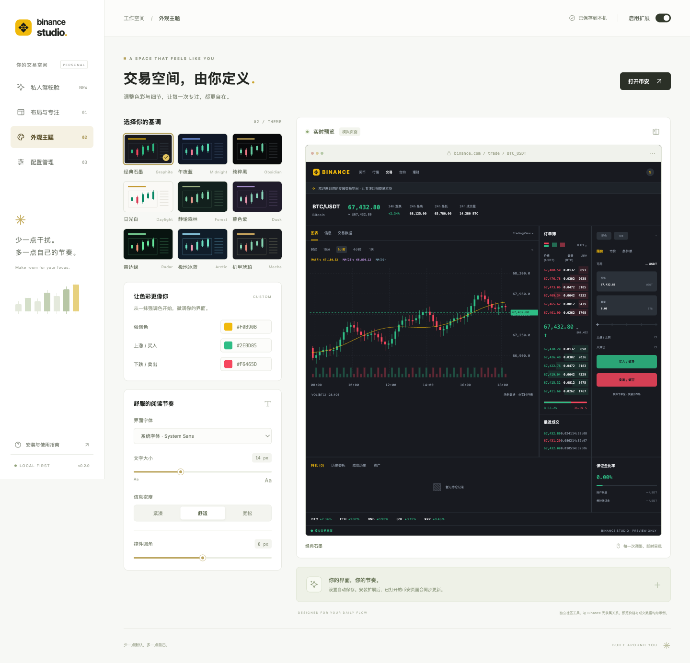
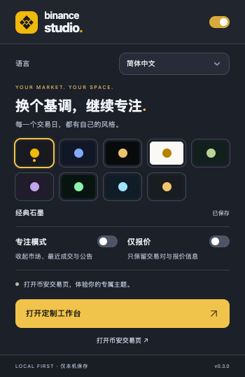
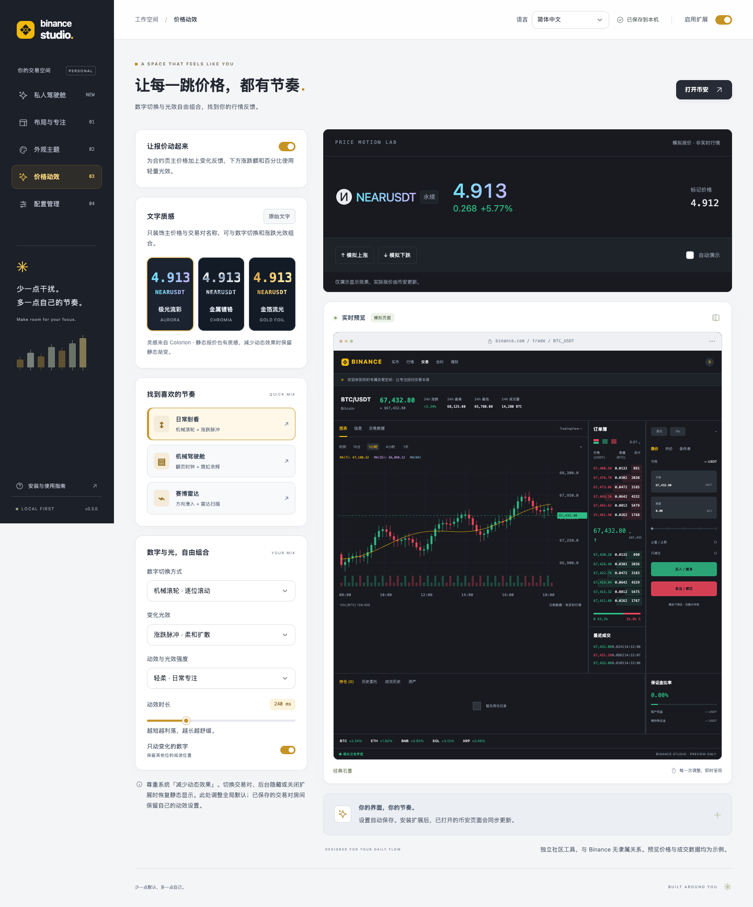
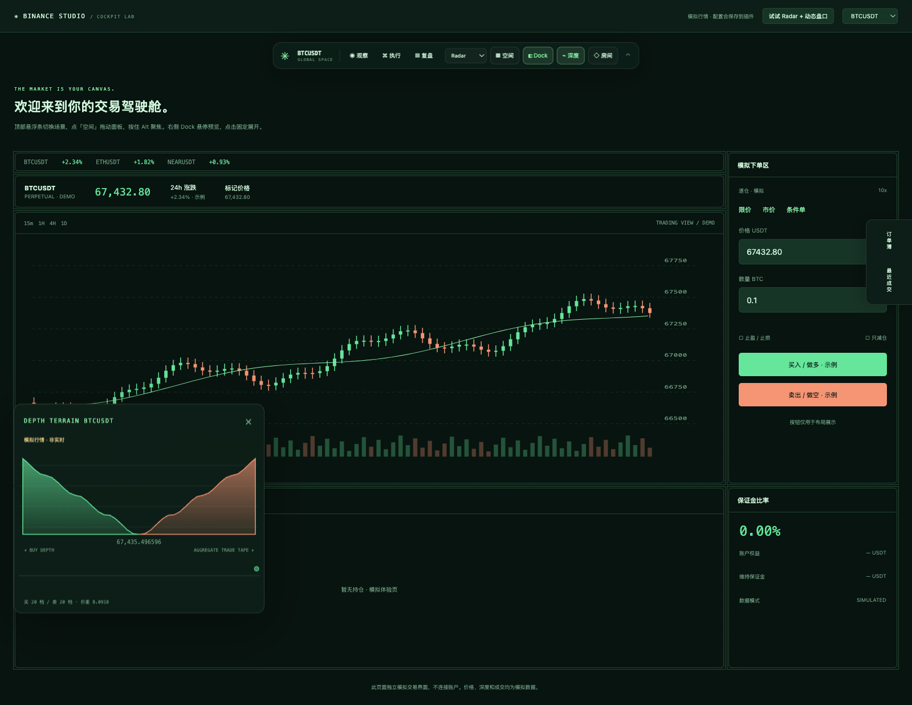
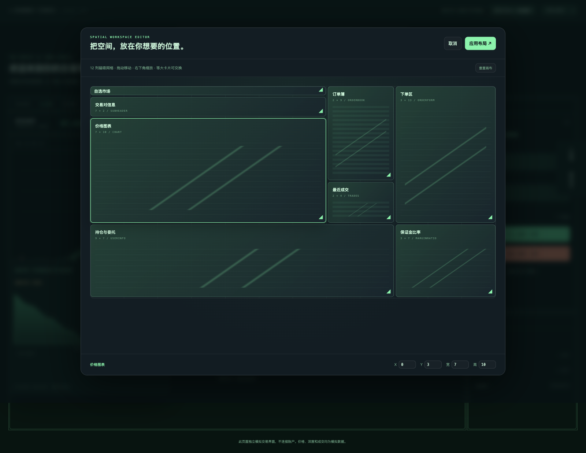

# Binance Studio

[English](README.md) | **简体中文**

一个本地优先的 Chrome / Edge 浏览器扩展，用于定制**币安全球站 `https://www.binance.com`** 的主题与交易界面。

## 界面预览

### 定制控制台

主题、配色、字体与布局集中调整，右侧实时预览效果。预览中的行情与交易界面均为模拟数据。



### Chrome 插件弹窗

从浏览器工具栏快速换肤、切换专注模式，或打开完整定制工作台。



<details>
<summary>查看价格动效、交易驾驶舱与空间编辑器</summary>

**价格动效控制台**：数字切换与光效自由组合，支持 NEARUSDT 模拟涨跌预览。



**Radar 驾驶舱**：场景切换、边缘 Dock 与动态盘口地形。截图来自模拟体验页，价格、深度与成交均为示例数据。



**空间编辑器**：在 12 列画布中拖动、缩放面板，也可以输入精确格位。



</details>

## 安装

1. 下载本项目，或运行 `npm run build` 后解压 `dist/binance-studio-0.3.0.zip`。
2. Chrome 打开 `chrome://extensions`，Edge 打开 `edge://extensions`。
3. 开启「开发者模式」，选择「加载已解压的扩展程序」，选择包含 `manifest.json` 的文件夹（项目根目录或 `dist/binance-studio`）。
4. 打开或**刷新**币安页面。在浏览器工具栏固定 Binance Studio 图标。
5. 点击图标快速换肤，或点击「打开定制工作台」调整完整设置。

更改设置会自动保存并同步到已注入扩展的币安标签页。关闭「启用扩展」会移除注入样式及面板标记，恢复网站原生显示。

已安装旧版时，在扩展管理页点击 Binance Studio 的「重新加载」，再刷新币安标签页。

## 界面语言

在工具栏弹窗或设置页顶部的「语言 / Language」中选择 **简体中文**、**English** 或默认的 **跟随浏览器 / Follow browser**。中文浏览器语言默认显示简体中文，其他语言默认显示英文。

语言选择保存在本机，并同步到已打开的扩展页面和页内驾驶舱，覆盖控件、预览、使用指南、错误提示、工具提示和无障碍标签。语言是全局偏好，交易对房间不会覆盖它；币安页面语言、用户输入的房间名和私人便签保持原样。独立预览单独保存自己的语言选择。

## v0.3 价格动效

打开定制工作台，选择「价格动效」。默认启用**机械滚轮 + 涨跌脉冲**，也可以一键选择「机械驾驶舱」或「赛博雷达」，再自由组合：

- **数字切换**：机械滚轮、翻页时钟、方向滑入、弹性跳字，或即时切换。
- **变化光效**：涨跌脉冲、霓虹余辉、雷达扫描、故障闪切，或关闭光效。
- **细节设置**：轻柔 / 适中 / 鲜明三档强度、120–600 ms 时长、仅变化位动效、独立启用开关。
- **模拟预览**：与截图对应的 NEARUSDT 主价格区域，可手动模拟上涨 / 下跌，或自动演示；不连接真实行情。

适配已核对的合约页 `.ticker-wrap` 主价格；涨跌额与百分比只使用较轻的光效。价格由原网页更新，动效以短暂的显示层呈现，保留原有文本节点、内联样式与交易输入。连续报价直接替换当前动画，缺失报价会清除显示层；切换交易对后重新建立基准，尊重系统「减少动态效果」，后台隐藏及暂停时恢复静态显示。房间保存与配置导入导出包含动效设置。

## v0.2 驾驶舱

在交易页面顶部的悬浮条中使用新功能。也可以在设置页点击「私人驾驶舱 → 进入模拟驾驶舱」体验，或在本地预览服务中打开 `/lab.html`。模拟页明确使用示例价格、深度与成交；其中的配置调整同样会保存。

- **空间编辑器**：点击「空间」，在 12 列画布中拖动和缩放面板，等大卡片可以交换。方向键移动，Shift + 方向键缩放，底部可输入精确格位。画布使用面板示意卡片，应用后重排原站卡片；不复制或移动交易表单。应用画布会展开其中的交易面板并暂停 Dock。取消或 Esc 不会保存。
- **边缘 Dock**：将盘口、最近成交、持仓与委托收进屏幕左 / 右侧。悬停预览，点击固定展开；「放回布局」将该面板从 Dock 中取出。原有 DOM 与输入值保留。标准布局会回收空间，自定义画布保持用户指定格位。
- **场景过渡**：观察、执行、复盘三个场景以平滑位移和缩放切换。可关闭动画，也会尊重系统的「减少动态效果」偏好。
- **聚光灯**：按住 Alt，鼠标所在面板保持亮度，其他区域降低亮度；松开、Esc、失焦或切换页面时恢复。在订单输入框等编辑区域内不触发；跨域 iframe 内的键盘事件由对应页面管理。
- **交易对专属房间**：点击「房间」保存皮肤、设置、空间画布与私人便签；启用自动房间后，现货 / 合约及不同交易对各自独立。最多保存 48 个房间。后台串行处理交易标签页的房间写入；全局暂停始终有效。设置页调整的是全局默认，已有房间可在对应交易对内调整或恢复全局设置。
- **四套驾驶舱皮肤**：Obsidian 黑金细线、Radar 荧光网格、Arctic 冰蓝圆角、Mecha 琥珀机甲边框。可继续微调颜色与字体。
- **动态盘口地形**：20 档累计买卖深度山脉、成交气泡带及相对较大成交的光轨。悬浮窗可拖动，跟随当前交易对；关闭、暂停扩展或标签页进入后台时断开连接。断线 / 超时清空过期快照并显示重连状态，不以模拟数据替代真实行情。

完整布局编辑依赖可识别的合约网格。动态行情支持现货和 USDⓈ-M 合约的公开流；不包含币本位合约。图表内部 Canvas / 跨域 iframe 配色仍由币安管理。

## 基础功能

- 九套主题：经典石墨、午夜蓝、纯粹黑、日光白、静谧森林、暮色紫、雷达绿、极地冰蓝、机甲琥珀。
- 自定义强调色、上涨色、下跌色；选择系统或等宽字体；调整字号、表格间距与控件圆角。
- 「图表优先」和「保留盘口」两种快捷专注方案。
- 页面最大宽度、图表高度、盘口宽度、下单区宽度、持仓区高度与面板间距。
- 镜像布局、专注模式，以及订单簿、最近成交、市场 / 自选列表、公告的显示开关。
- 当前合约网格支持隐藏面板后自动重排；单独重置布局可保留主题设置。
- 带明确示例标识的模拟交易界面，实时呈现设置；支持原生样式对比。
- JSON v2 配置导入导出，包含全局设置、自定义画布、房间与便签，最大 1 MB；兼容导入旧版 v1 设置。恢复默认会保留已保存的房间备份。
- 工具栏弹窗提供快捷主题切换、暂停开关，以及当前标签页的面板识别状态。

## 适配范围与已知边界

**适配基于对合约页 DOM 的只读观察和重建测试页面，尚未在真实交易页完成扩展端到端验收。** 币安更新页面结构后，部分主题或布局功能可能需要调整选择器。

自动化测试实际加载扩展，覆盖通用测试页面与按观察到的真实合约结构重建的测试页面，不能代表所有现货、合约和语言版本。安装后可通过弹窗检查是否识别为「合约网格适配」。

主题通过币安的语义 CSS 变量与部分控件类生效。币安有独立背景色、字号或 Canvas 绘制的组件不一定跟随所有设置。TradingView / 原生图表的 Canvas 内容与跨域 iframe 不在 CSS 调整范围内，需使用币安自身图表设置。

当前合约页适配器识别 `.react-grid-layout`、`.react-grid-item` 及卡片内的 `grid-area`，支持 `favorite`、`subheader`、`chart`、`orderbook`、`trades`、`orderform`、`userinfo`、`marginRatio` 八个分区。原生布局且无尺寸或显示调整时，保留网站自身布局；启用专注、镜像或尺寸调整后，通过 CSS Grid 重排外层卡片，隐藏面板后回收空间。不会移动 DOM、修改原有内联样式或下单字段；重置布局 / 暂停扩展可恢复原站布局。

网格出现未知或重复分区时停止整页重排，避免币安新增面板被遗漏。通用适配使用 `src/core.js` 的 `PANEL_SELECTORS`，仅调整已识别的区域；通用网格可能保留空轨道。镜像还支持已识别图表和盘口的公共 Grid / 横向 Flex 容器。原站拖动与调整大小功能不适用于扩展接管后的网格，可先重置扩展布局再使用原站拖动。币安改版后可在选择器与 `GRID_AREAS` 中增补适配。

支持币安全球站根域和 `www` 域名；不包含 Binance.US 或其他地区独立域名。手机宽度布局适用于设置页，扩展本身面向桌面 Chrome / Edge。

## 本地开发与验证

运行时无第三方依赖，也无需构建即可安装。开发需要 Node.js 20 或更高版本和 npm；打包还需要系统提供 `zip` 命令。

```sh
npm run dev
# 打开 http://127.0.0.1:4173

npm run check
npm test
npm run build

# 仅浏览器自动化测试需要安装开发依赖和 Chromium
npm ci
npx playwright install chromium
npm run test:browser
```

独立预览使用 `localStorage`，与安装后的扩展存储相互独立。可通过导出、导入配置迁移设置。安装后的扩展使用 `chrome.storage.local`；多个扩展页面和内容脚本监听存储变更。存储写入失败会在界面中提示。

`npm run test:i18n` 单独验证双语界面、语言保存与同步，以及切换语言时对输入内容的保留。

浏览器测试实际加载未打包的 Manifest V3 扩展，验证原有功能以及空间编辑、场景过渡、减少动态效果、Dock、聚光灯、交易对房间、SPA 切换、行情重连 / 关闭和模拟体验页。Binance 域名请求返回 `tests/fixtures` 中的重建页面；行情测试在临时测试浏览器的扩展隔离环境中注入 WebSocket 替身，使用公开流格式的固定数据，不访问账户、不提交交易。截图与测试结果在 `output/verification`。CI 在 Node.js 20 和 22 上执行资源检查、单元测试、打包与四组浏览器测试。`npm run test:cockpit` 可单独运行驾驶舱验证。

`npm run test:prices` 单独验证价格动效：真实加载扩展，使用按只读观察重建的合约报价结构，覆盖动效组合、连续跳价、缺失报价、节点替换、交易对切换、减少动态效果、独立关闭、全局暂停及响应式预览。后台恢复逻辑使用模拟的可见性事件验证。

可选环境变量 `BROWSER_EXECUTABLE` 指定支持扩展侧载的 Chromium / Chrome for Testing。较新版本的正式 Chrome 已限制命令行侧载，建议使用 Playwright Chromium。

## 文件结构

```text
manifest.json           扩展权限与入口
options.html            完整设置工作台
popup.html              工具栏快捷弹窗
lab.html                可交互的驾驶舱模拟体验
src/storage.js          扩展与独立预览共用的存储边界
src/i18n.js             语言选择与限定作用域的界面翻译
src/locales/en.js       以中文原文为键的英文翻译
_locales/               浏览器原生扩展名称与描述翻译
src/core.js             设置校验、主题生成和配置格式
src/content.js          币安页面样式注入与面板识别
src/background.js       默认设置初始化与多标签页串行写入
src/workspace.js        空间画布、交易对房间、v2 配置与校验
src/cockpit.js          页内控制条、编辑器、Dock 与聚光灯
src/market.js           公开行情客户端与深度 / 成交 Canvas
src/price-effects.js    主价格数字切换、变化光效与生命周期
src/price-options.js    价格动效设置与模拟报价预览
src/experiments.js      驾驶舱设置与房间列表
src/lab.js              模拟交易页
src/options.js          工作台交互
src/popup.js            快捷设置与页面连接状态
src/preview.js          示例交易界面
styles/                 工作台与弹窗样式
assets/                 本地图标
docs/screenshots/       README 界面截图
tests/                  单元测试与浏览器验证
scripts/                本地预览服务、资源检查和发布打包
```

## 权限与数据

仅申请 `storage` 与 `activeTab`。内容脚本的自动注入范围限定为 `https://www.binance.com/*` 和 `https://binance.com/*`。`activeTab` 用于用户主动打开插件时检测当前币安页面；不读取其他标签页历史。不需要 API Key，不访问 cookie，不收集分析数据，不修改下单逻辑。

动态盘口默认关闭；开启后只向 Binance 公开 WebSocket 订阅当前交易对的深度和聚合成交，不发送便签、余额、订单或账户信息。当前合约接口分别使用 `wss://fstream.binance.com/public/ws/` 与 `/market/ws/`；现货使用 `wss://stream.binance.com:9443/stream`。网络、地区或站点 CSP 限制可能使行情连接失败，界面会显示状态。

配置保存在本机，不通过浏览器账户云同步；卸载扩展会删除扩展存储，可提前导出备份。本工具为独立社区项目，与 Binance 无隶属关系。

实现参考：[Chrome 内容脚本](https://developer.chrome.com/docs/extensions/develop/concepts/content-scripts)、[Chrome Storage](https://developer.chrome.com/docs/extensions/reference/api/storage)、[Playwright 扩展测试](https://playwright.dev/docs/chrome-extensions)。

公开行情协议：[USDⓈ-M 深度流](https://developers.binance.com/en/docs/catalog/core-trading-derivatives-trading-usd-s-m-futures/api/ws-streams/public)、[USDⓈ-M 成交流](https://developers.binance.com/en/docs/catalog/core-trading-derivatives-trading-usd-s-m-futures/api/ws-streams/market)、[现货行情流](https://developers.binance.com/en/docs/catalog/core-trading-spot-trading/api/ws-streams/~)。

## 参与贡献

欢迎用中文或英文提交 Issue 和 Pull Request。开发约定、验证流程与发布步骤见 [贡献指南](CONTRIBUTING.md)，模块依赖与存储设计见 [架构说明](docs/ARCHITECTURE.md)。

`package.json` 中的 `private: true` 用于防止误发布到 npm，不影响从源码安装浏览器扩展。扩展界面与项目文档均支持英文和简体中文。

## 许可证

本项目采用 [Apache License 2.0](LICENSE)。导出的配置包含私人便签，分享前请检查内容。
